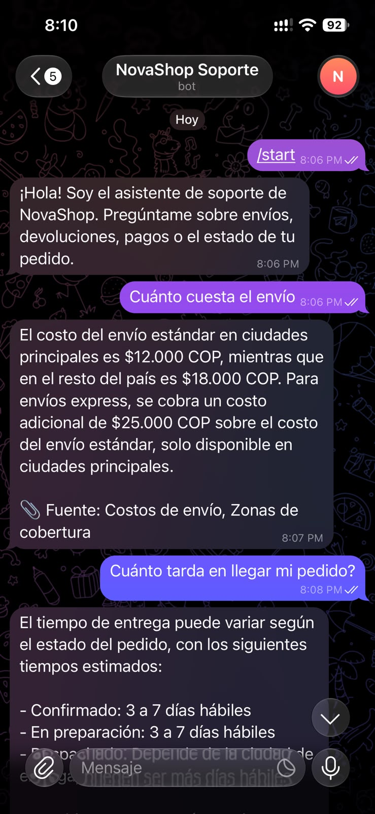
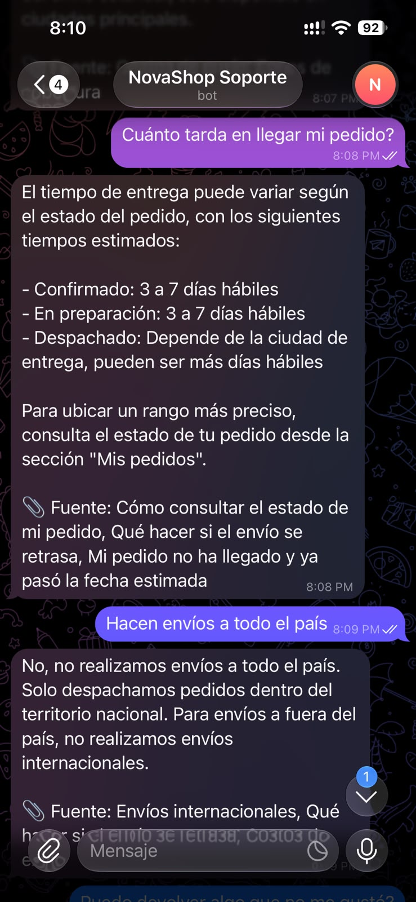
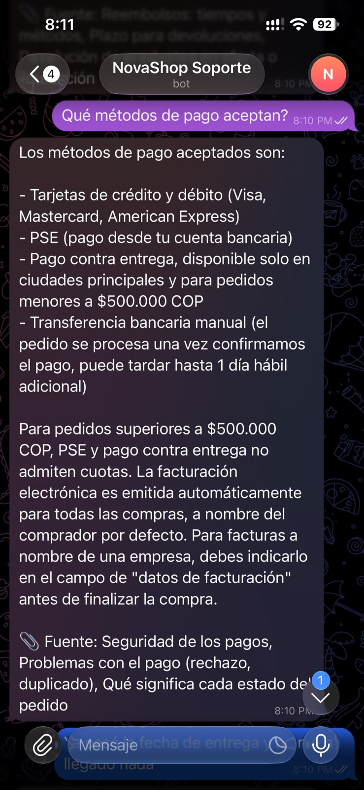
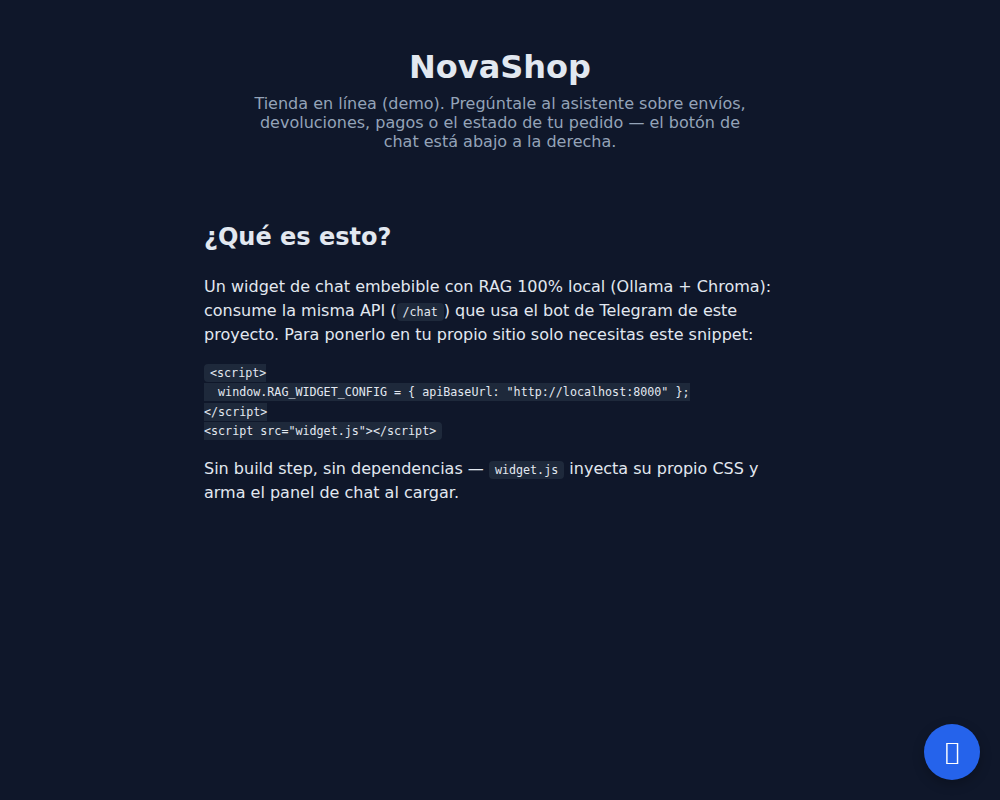
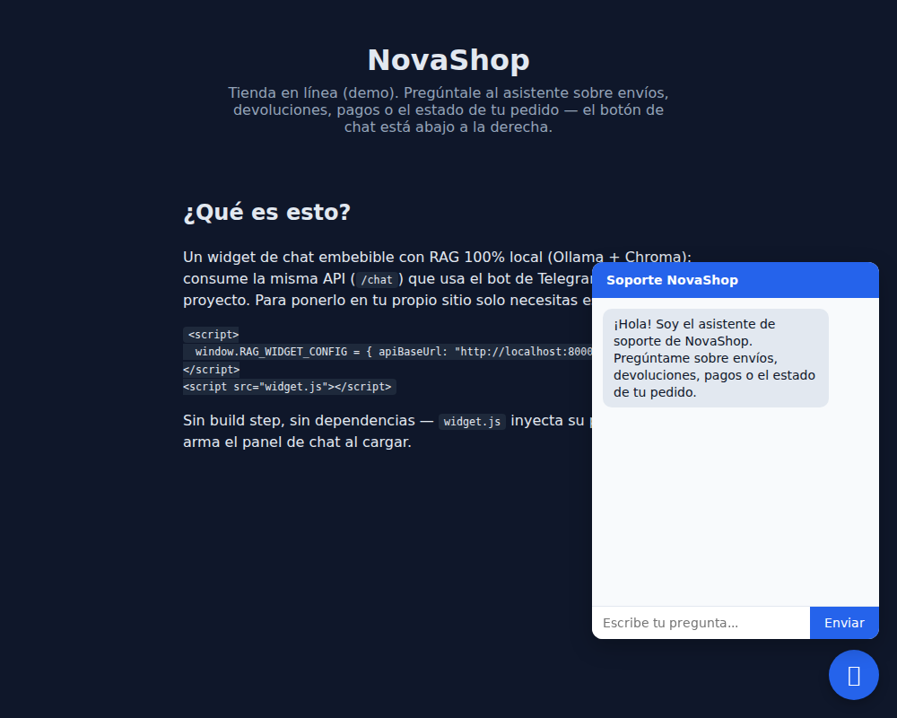
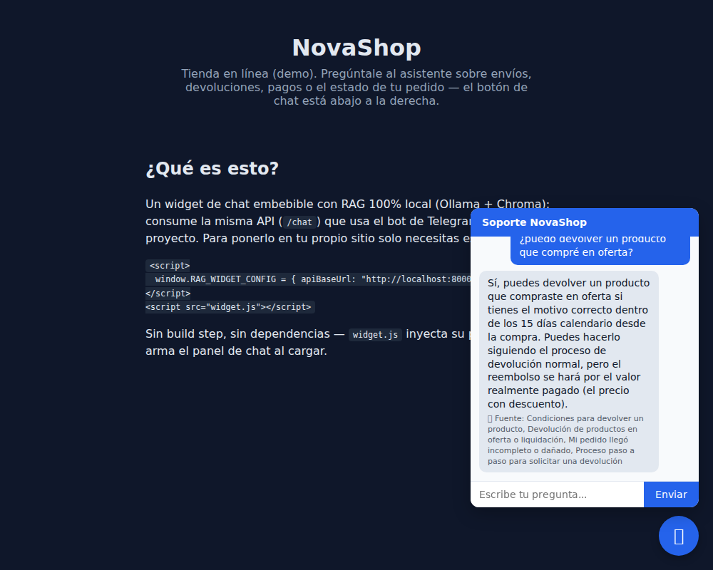

# Asistente FAQ con RAG — Telegram + Widget Web

Asistente de soporte con **RAG 100% local** (sin APIs pagas) para un e-commerce ficticio ("NovaShop"): responde preguntas sobre envíos, devoluciones, pagos y estado de pedidos, citando siempre la sección fuente de la respuesta. Corre por **Telegram** (long-polling, sin servidor público) y por un **widget de chat embebible** en cualquier sitio web — ambos canales comparten el mismo motor de RAG.

Todo el stack (LLM, embeddings, base vectorial) corre en tu propio equipo con [Ollama](https://ollama.com) + [Chroma](https://www.trychroma.com): sin OpenAI, sin Anthropic, sin costo variable por uso.

## Funcionalidades

- 🤖 **Bot de Telegram** por long-polling — sin webhook, sin dominio, sin servidor público.
- 💬 **Widget de chat embebible**: un solo `<script src="widget.js">`, sin build step, inyecta su propio CSS.
- 📎 **Citas de fuente** en cada respuesta — qué sección de la base de conocimiento se usó.
- 🛡️ **Guardrail anti-alucinación de dos capas**: instrucción en el system prompt + corte determinístico (sin llamar al LLM) cuando no hay contexto relevante — necesario porque el prompt solo no bastaba con el modelo chico usado aquí (ver [`eval/golden_questions.md`](eval/golden_questions.md)).
- 🧠 **Memoria de conversación** persistente (SQLite), por chat de Telegram o por sesión del widget — sobrevive a reinicios del contenedor.
- 🐳 **Docker Compose** de un solo comando: Ollama + ingesta + API + bot.
- ✅ **Evaluación manual documentada**: 20 preguntas reales probadas contra el stack completo, con los fallos reales encontrados y por qué — ver [`eval/golden_questions.md`](eval/golden_questions.md).

## Capturas

### Bot de Telegram

  

### Widget web embebible





## Stack técnico

- **LLM**: Ollama, `qwen2.5:3b-instruct` por defecto (corre con ~4GB RAM libres; `OLLAMA_CHAT_MODEL` permite cambiar a un modelo mayor si hay más recursos).
- **Embeddings**: Ollama, `nomic-embed-text`.
- **Vector DB**: Chroma, embebido, persistencia local (distancia coseno).
- **Memoria de conversación**: SQLite.
- **Bot**: `python-telegram-bot` (polling).
- **API**: FastAPI + uvicorn.
- **Widget**: HTML/CSS/JS vanilla, sin dependencias ni build step.
- **Python 3.12**, todo dockerizado con Docker Compose.

## Arquitectura

```
data/kb/*.md ──ingest.py──> Chroma (embeddings locales)
                                   │
                    ┌──────────────┴──────────────┐
                    │                              │
              rag.py (retrieval + prompt + citas + guardrail)
                    │                              │
              bot.py (Telegram)              api.py (FastAPI) ──> web/widget.js
                    │                              │
              memory.py (SQLite, historial de conversación por sesión)
```

Bot y widget son dos *adaptadores* sobre el mismo núcleo (`rag.py` + `memory.py`) — no hay lógica duplicada entre canales.

## Cómo correrlo

```bash
cp .env.example .env
# Editar .env: pegar tu TELEGRAM_BOT_TOKEN (crealo con @BotFather en Telegram)

docker compose up -d --build
```

Esto levanta, en orden: `ollama` (con healthcheck) → `ollama-init` (descarga los modelos una vez, idempotente) → `ingest` (carga la KB en Chroma, idempotente) → `api` y `bot`.

- API: `http://localhost:8000` (`GET /health`, `POST /chat`).
- Bot: búscalo en Telegram con el username que le diste en BotFather.
- Widget de demo: `cd web && python3 -m http.server 8080` y abre `http://localhost:8080` (con la API corriendo en Docker).

### Correr sin Docker (desarrollo)

```bash
python3 -m venv .venv && .venv/bin/pip install -r requirements.txt
ollama pull nomic-embed-text && ollama pull qwen2.5:3b-instruct
.venv/bin/python -m src.ingest
.venv/bin/uvicorn src.api:app --reload   # o: .venv/bin/python -m src.bot
```

Con `OLLAMA_HOST=http://localhost:11434` en tu `.env` (no `http://ollama:11434`, que es solo para Docker).

### Tests

```bash
.venv/bin/pytest
```

23 tests — chunking, retrieval (umbral de relevancia, construcción del prompt), memoria de conversación (SQLite) y el contrato de la API. Todos corren sin red, sin depender de Ollama ni Docker.

## Limitaciones conocidas

Documentadas con evidencia real en [`eval/golden_questions.md`](eval/golden_questions.md), no solo enumeradas:

1. **El embedding puede fallar con preguntas naturales**: la sección que responde "¿cuánto tarda en llegar mi pedido?" cae al puesto #19 de 23 con esa frase, pero al puesto #2 si se usa la frase literal del título de la sección. Limitación de `nomic-embed-text` con paráfrasis en español.
2. **"Lost in the middle"**: con el chunk correcto confirmado dentro del prompt (4° de 5 bloques), el modelo de 3B a veces igual responde "no tengo esa información" — reproducido 5/5 veces con dos preguntas distintas.
3. **Alucinación por combinación de secciones**: el modelo puede inventar una condición de negocio que no existe, mezclando datos de dos secciones distintas de la KB (reproducido 3/3 veces).
4. **Dos secciones muy parecidas** ("pedido incompleto" vs. "pedido no ha llegado") a veces no se distinguen bien — caso límite diseñado a propósito en la KB para medir esto.

## Roadmap

- [ ] Modelo más grande (`qwen2.5:7b-instruct` / `llama3.1:8b-instruct`) si hay más RAM disponible — mitigaría los hallazgos 2 y 3.
- [ ] Hybrid search (BM25 + embeddings) y/o reranking local (`bge-reranker`) — mitigaría el hallazgo 1.
- [ ] Evaluación sistemática con [RAGAS](https://github.com/explodinggraph/ragas) en vez de un checklist manual.
- [ ] Reformular la query de retrieval con el historial de conversación (hoy solo se embebe el mensaje actual — un seguimiento muy corto como "¿y el estándar?" puede no encontrar contexto).

## Despliegue y escalamiento (guía, no ejecutado en este MVP)

Todo corre en local durante el desarrollo. Para un demo público:

1. **Demo puntual, cero servidor**: túnel gratuito (Cloudflare Tunnel / ngrok) mientras dura la demo.
2. **Demo permanente, aún gratis**: el mismo `docker-compose.yml` en una VM "Always Free" (Oracle Cloud) o el free tier de Fly.io. El widget (`web/`) se despliega aparte en Vercel/Netlify apuntando a esa VM.
3. **Si se quiere escalar a multi-cliente** (varios negocios, cada uno con su KB y login): Supabase sirve para Auth + Postgres con `pgvector` (reemplazando a Chroma) — pero **no** para correr Ollama, que seguiría necesitando una VM aparte o, solo para la instancia pública, una API de inferencia gestionada con capa gratuita (Groq/OpenRouter) sin tocar la arquitectura de `rag.py`.

## Licencia

MIT.
